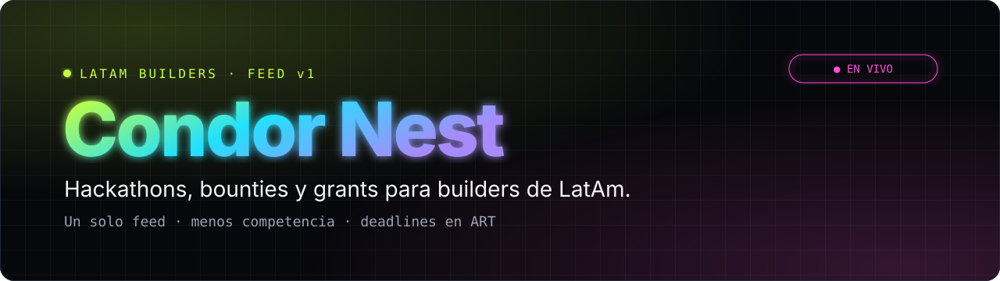
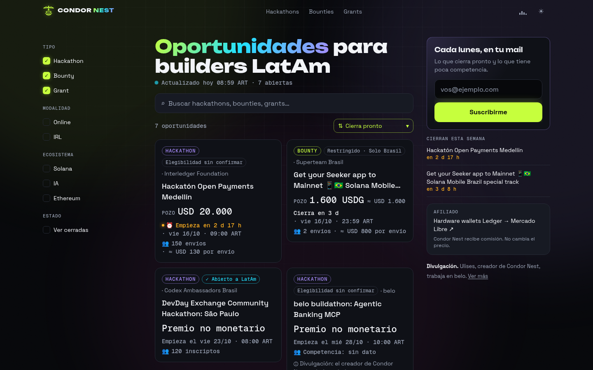
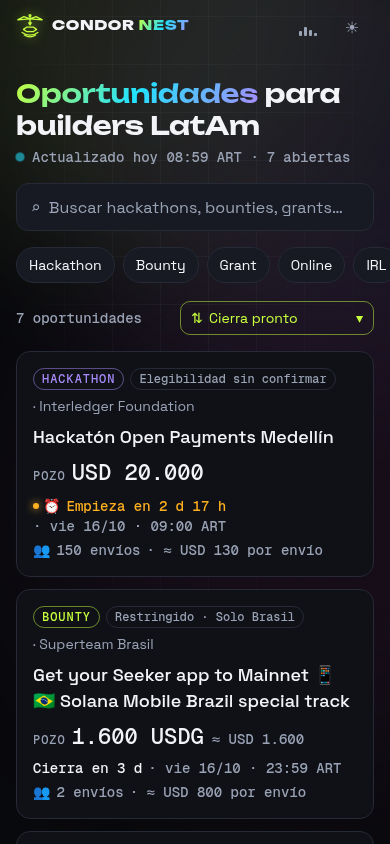

<p align="center">
  
</p>

<p align="center">
  <a href="https://condor-nest.lat"></a>
  
  
  
  
</p>

<p align="center"><code>Un solo feed · menos competencia · deadlines en tu hora local</code></p>

---

## ◆ Qué es

**Condor Nest** junta en un solo feed los **hackathons, bounties y grants** abiertos para builders de Latinoamérica. Español primero, dark-first y pensado para encontrar rápido dónde tenés más chances de ganar.

<p align="center">
  
  &nbsp;
  
</p>

## ⚡ Features

| | |
|---|---|
| 🌎 **Filtro LatAm** | Sólo oportunidades abiertas a builders de LatAm, con elegibilidad marcada en cada card. |
| 🎯 **Orden "menos competencia"** | Rankea por pozo vs. envíos/inscriptos (≈ USD por envío). |
| ⏰ **Deadlines en tu hora** | Las fechas se muestran en la zona horaria del visitante (detectada en el navegador, con fallback a Buenos Aires), con "cierra en…" en vivo. |
| 🛰️ **Fuentes** | Superteam Earn API · Devpost · Taikai · eventos curados desde X (verificados en su página oficial y con el post de origen citado). |
| 🔎 **Filtros** | Tipo, modalidad (online / IRL), ecosistema (Solana, IA, Ethereum) y "Ver cerradas". |
| 🎧 **Lo-fi de fondo** | Con fade-in al iniciar y fade-out al pausar o cambiar de pestaña. |
| 📬 **Newsletter** | "Cada lunes, en tu mail": lo que cierra pronto y lo que tiene poca competencia. |

## 🧱 Stack

- **Next.js 15** (App Router, TypeScript) + Tailwind + Motion
- **Supabase** (Postgres + RLS + Vault): tablas `listings`, `ingest_runs`, `newsletter_subscribers`
- **Vercel**: hosting + Vercel Cron
- Tipografías **Geist** / **Geist Mono**; tokens de color en `app/globals.css`

<table><tr>
<td> lime</td>
<td> cyan</td>
<td> violet</td>
<td> magenta</td>
<td> bg</td>
</tr></table>

## 🛠️ Setup local

```bash
git clone https://github.com/ulises-ASTRADA/condor-nest.git
cd condor-nest
npm install
cp .env.example .env.local   # completá los valores (nunca los commitees)
npm run dev                  # http://localhost:3000
npm test                     # tests del ranking
```

### Variables de entorno

Sólo los **nombres**; los valores viven en `.env.local` y en Vercel.

| Variable | Dónde | Para qué |
|---|---|---|
| `NEXT_PUBLIC_SUPABASE_URL` | cliente | URL del proyecto Supabase |
| `NEXT_PUBLIC_SUPABASE_ANON_KEY` | cliente | Key pública (anon) |
| `SUPABASE_SERVICE_ROLE_KEY` | **sólo server** | Escrituras del ingest. Nunca con prefijo `NEXT_PUBLIC_`. |
| `INGEST_TOKEN` | server | Autoriza `cn_ingest` en la base |
| `CRON_SECRET` | server | Autentica las llamadas de Vercel Cron |
| `AFFILIATE_URL` | server | Link de afiliado (Mercado Libre) |
| `NEXT_PUBLIC_TURNSTILE_SITE_KEY` / `TURNSTILE_SECRET_KEY` | cliente / server | Anti-bot del newsletter (opcional) |
| `SITE_URL` | server | Origen público (`https://condor-nest.lat`) para links de confirmación |
| `RESEND_API_KEY` / `RESEND_FROM` | server | Newsletter y avisos de /publicar. `RESEND_FROM` solo con dominio verificado en Resend |
| `PUBLICAR_NOTIFY_TO` | server | Destino de avisos de /publicar (default: mail de Ulises) |

## 🔁 Ingest diario

`vercel.json` programa `GET /api/cron/ingest` con `0 11 * * *` → **08:00 ART**. En el plan Hobby, Vercel puede dispararlo en cualquier momento dentro de esa hora (08:00–08:59 ART).

- Trae Superteam Earn, Devpost y Taikai; deduplica por `(source, external_id)`.
- Cada corrida queda registrada en `ingest_runs`.
- Los eventos curados (Luma / X) se cargan sólo después de verificarlos en la página oficial (`verified_url`). Ver [`docs/x-sweep.md`](docs/x-sweep.md).

## 🔐 Seguridad

Headers estrictos (CSP, X-Frame-Options, nosniff), grants mínimos en la base, token de ingest en Supabase Vault e indexación activada (robots.txt, sitemap.xml, llms.txt y JSON-LD) desde el 14/10/2026; `noindex` solo en /api, /newsletter y previews.

## 🤝 Transparencia

El link de Mercado Libre es de afiliado: Condor Nest recibe comisión y no cambia el precio.

## 🎵 Música

La pista de fondo (`public/audio/condor-nest-lofi.mp3`) es un **original de Lo-Fi Mate** hecho para Condor Nest.

---

<p align="center"><sub>Hecho en Córdoba, para LatAm · <a href="https://condor-nest.lat">condor-nest.lat</a></sub></p>
